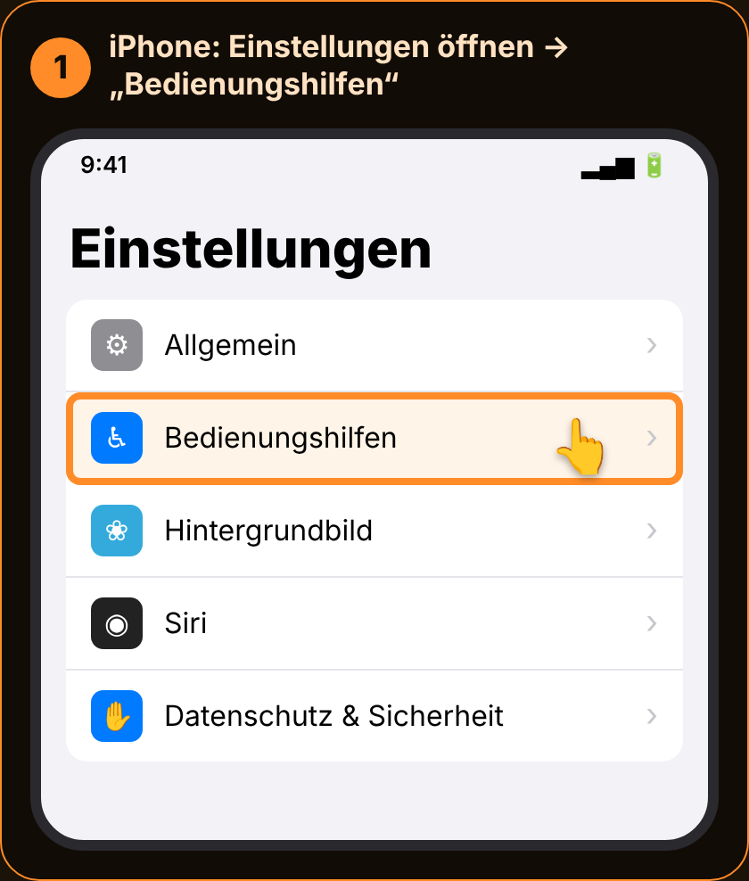
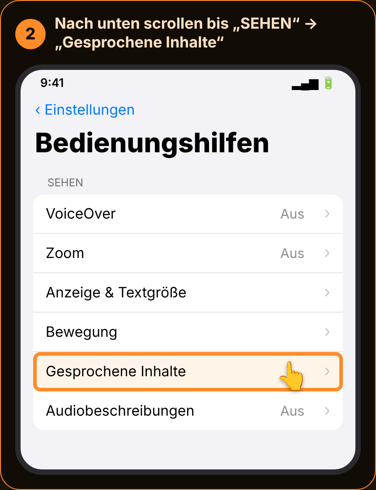
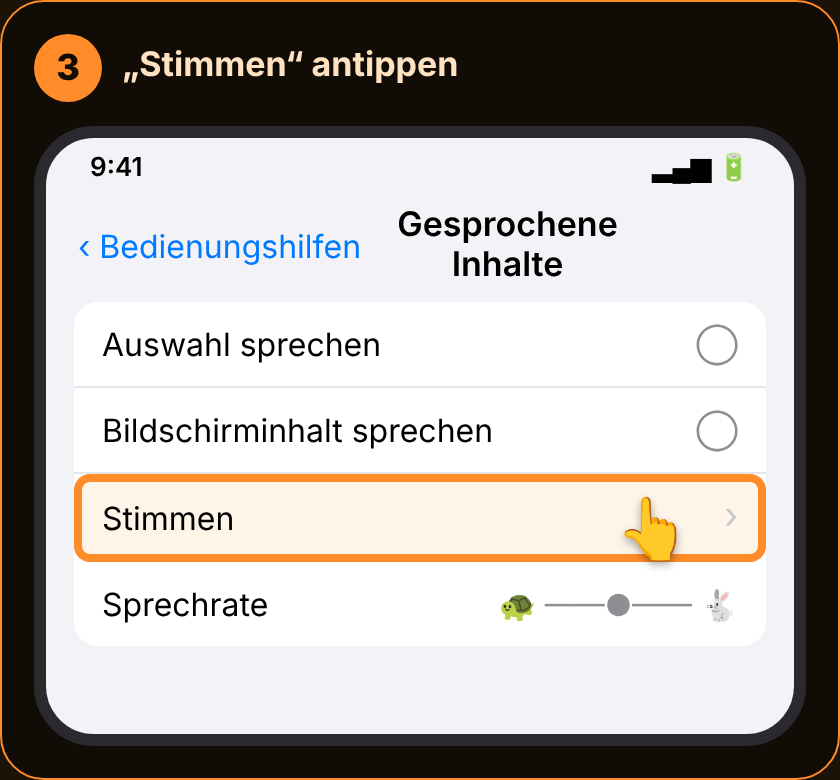
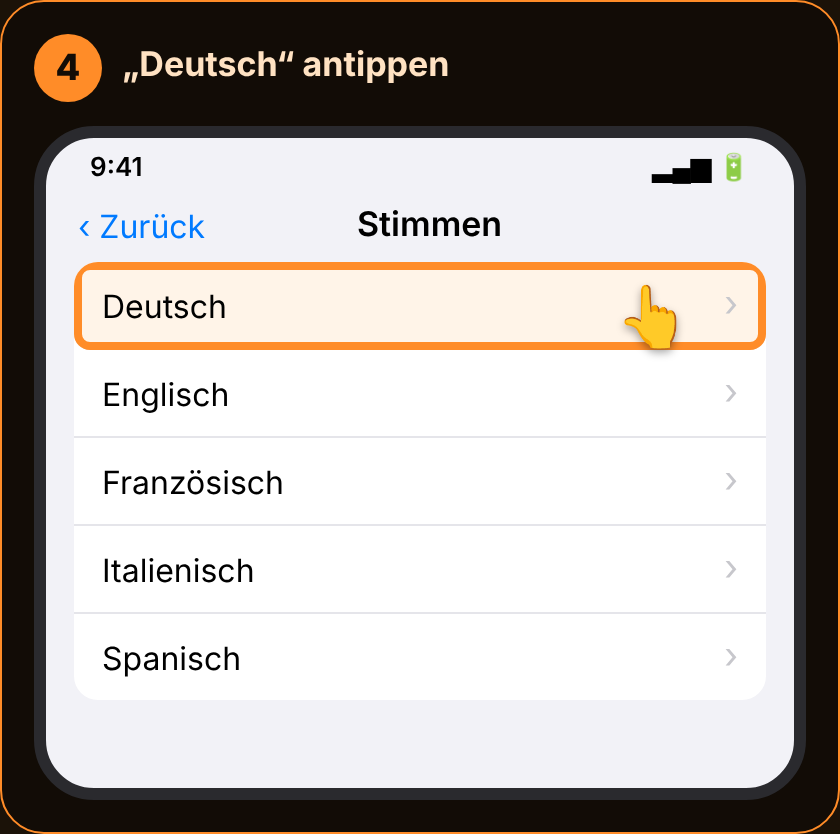
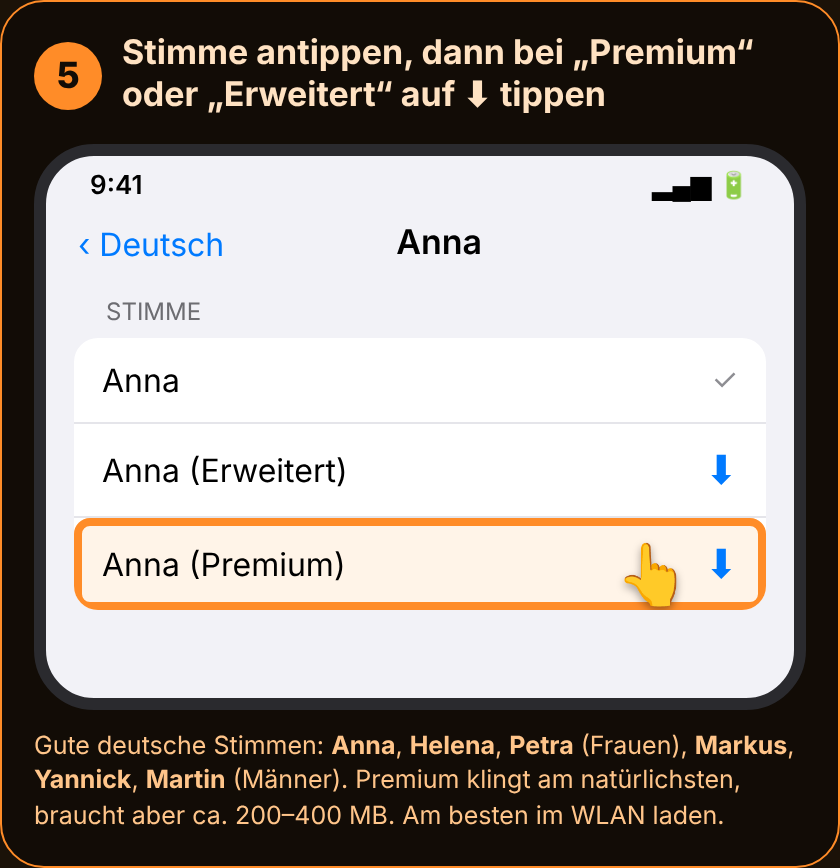
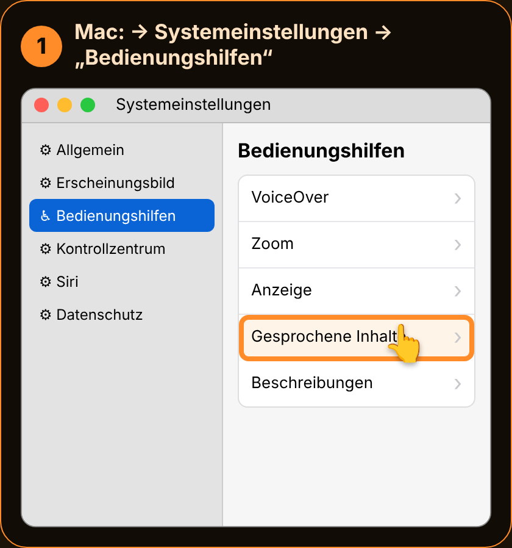
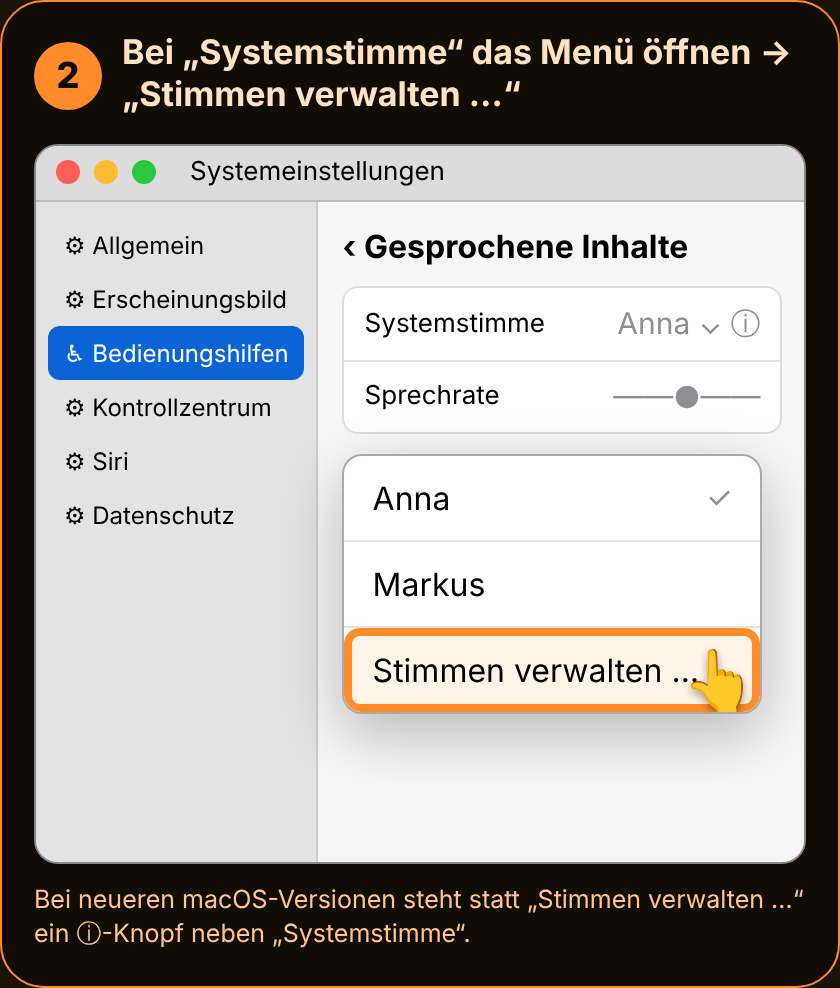
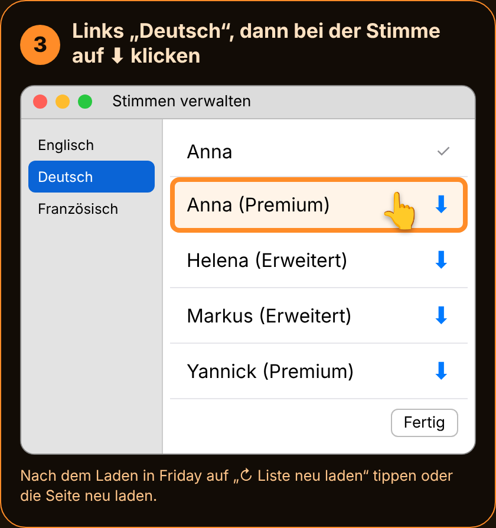
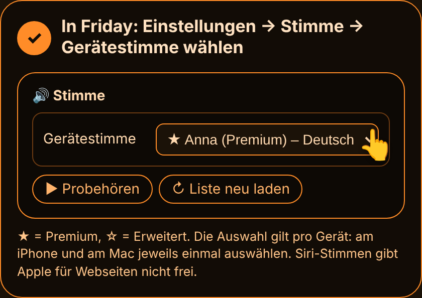

# Apple-Stimmen für Friday laden (mit Bildern)

Seit v1.123.0 spricht Friday nur noch mit den Apple-Stimmen (ElevenLabs ist entfernt).
Die schönsten deutschen Stimmen (**Premium** und **Erweitert**) sind kostenlos, müssen aber einmal geladen werden.
In Friday gibt es dieselbe Anleitung unter Einstellungen → Stimme → „Mehr Apple-Stimmen laden“ → „📷 Anleitung mit Bildern öffnen“.

## 📱 iPhone

## 💻 Mac

## ✅ In Friday auswählen

Die Bilder sind nachgebaut und können je nach iOS-/macOS-Version leicht anders aussehen.
Siri-Stimmen gibt Apple für Webseiten nicht frei.
